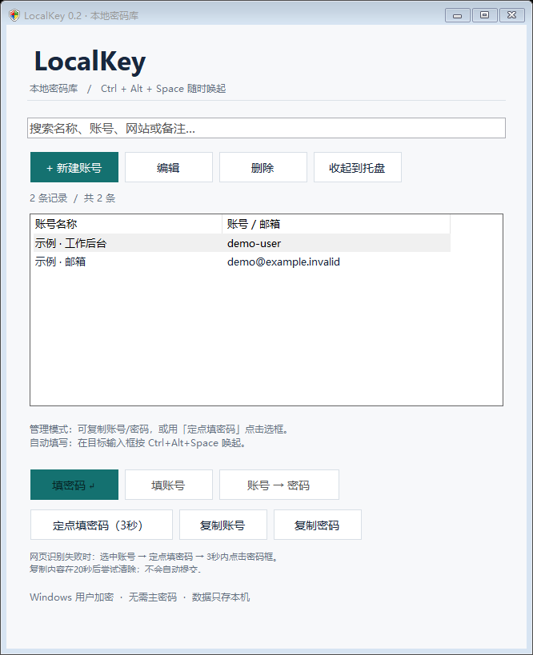

# LocalKey

Windows 本地账号密码工具。通过全局快捷键唤起，搜索自己的账号，将内容填回浏览器或桌面软件的输入框。

[English](README.en.md) · [操作手册](操作手册.md) · [构建说明](docs/BUILDING.md) · [安全说明](SECURITY.md) · [MIT 协议](LICENSE)

**下载：** [单文件 EXE](https://github.com/DoubleYang168/LocalKey/releases/download/v0.2.0/LocalKey-0.2.0-windows.exe) · [Windows 便携包](https://github.com/DoubleYang168/LocalKey/releases/download/v0.2.0/LocalKey-0.2.0-windows.zip) · [全部版本](https://github.com/DoubleYang168/LocalKey/releases)



## 功能

- 管理账号名称、用户名、密码、网站 / 应用和备注，支持搜索和随机密码生成。
- **Ctrl+Alt+Space** 全局唤起，提供仅填账号、仅填密码、账号后 Tab 再填密码。
- **定点填密码**：倒计时内重新点击目标框，向选中的单个可编辑框输入密码，兼容未提供密码标记的表单。
- 主动复制账号或密码，20 秒后尝试清除本程序仍拥有的剪贴板内容。
- 常驻托盘，闲置约 5 分钟或 Windows 锁屏后清除内存中的账号列表。
- 使用 Windows DPAPI `CurrentUser` 加密本地密码库，无需单独主密码。

自动与定点填写不经过剪贴板，不会自动提交表单。应用没有账号注册、云同步、遥测或联网客户端。

## 使用前了解

**LocalKey 依赖当前 Windows 用户身份，没有独立主密码。** 能操作已登录会话的人也能打开密码库；它不提供同一 Windows 用户下的恶意软件隔离。

密码库绑定 Windows 用户的加密密钥。换用户、换电脑、重装系统或丢失密钥后，可能无法解密；**只复制密码库文件不等于完成迁移备份**。当前没有跨电脑导出功能。

项目处于早期版本，未经过独立安全审计。完整数据保护范围见 [安全与隐私](docs/PRIVACY.md)。

## 安装和运行

支持 Windows 10 / 11 桌面环境，要求 .NET Framework 4.8。构建脚本要求 64 位 Windows；程序编译为 AnyCPU，当前主要验证环境为 x64 Windows。

### 使用发行包

在 GitHub 仓库的 **Releases** 页面选择下载：

| 文件 | 使用方式 |
| --- | --- |
| `LocalKey-0.2.0-windows.exe` | 单文件程序，下载后直接运行，无需编译或安装 |
| `LocalKey-0.2.0-windows.zip` | 推荐：解压后运行 `LocalKey.exe`，附许可证和操作手册 |
| `LocalKey-0.2.0-source.zip` | 开发者源码包，普通用户不需要下载 |
| `SHA256SUMS.txt` | 上述三个文件的 SHA-256 校验值 |

运行前按发行说明核对校验值。便携包也可通过包内的 `启动LocalKey.cmd` 启动。EXE 仍需要系统已安装 .NET Framework 4.8。

如果仓库尚未提供发行包，按下面的方法从源码构建。当前程序未做代码签名；校验值用于检查文件完整性，不是安全审计或发布者身份的证明。

### 从源码运行

在源码根目录打开 PowerShell：

```powershell
.\build.ps1
.\启动LocalKey.cmd
```

输出位于 `dist/0.2.0/LocalKey.exe`。无需安装 .NET SDK、Visual Studio 或 NuGet 包；使用 Windows 自带的 .NET Framework C# 编译器。遇到脚本执行策略限制时，按自己的组织策略处理；也可参考 [直接调用编译器](docs/BUILDING.md#直接调用编译器)。

程序不安装服务，不自动开机启动，也不更改浏览器配置。关闭主窗口会回到托盘；完全退出请使用托盘菜单「退出 LocalKey」。升级前先退出正在运行的旧实例。

## 快速使用

1. 点击「新建账号」，保存一条自己的记录。
2. 在浏览器或其他软件里点击要填的输入框；需要覆盖旧文字时先选中旧文字。
3. 按 **Ctrl+Alt+Space**，搜索并选中正确记录，核对目标窗口。
4. 选择「填账号」「填密码」或「账号 → 密码」，填写后自行检查和提交。

网页提示「未识别到密码框」时：选中账号 → **定点填密码（3秒）** → 在倒计时内重新点击实际密码框 → 等待填写。没有新点击就不会输入，Esc 可取消。定点模式不检查密码属性，选到普通文本框时内容可能明文显示。

如仍不支持该控件，可主动点击「复制密码」，到目标框按 Ctrl+V。20 秒后的清理是尽力执行；其他剪贴板工具仍可能读取内容。

| 快捷键 | 范围 | 操作 |
| --- | --- | --- |
| Ctrl+Alt+Space | 全局，程序运行时 | 从当前输入框唤起；主窗口已聚焦时隐藏 |
| Enter / Ctrl+Enter | 主窗口，有自动填写目标 | 填密码 / 账号后 Tab 填密码 |
| Alt+P | 主窗口，已选记录 | 开始定点填密码 |
| Ctrl+Shift+C / Ctrl+Shift+U | 主窗口，已选记录 | 复制密码 / 复制账号 |
| ↑ / ↓ | 搜索框 | 切换选中记录 |
| Ctrl+L | 主窗口 | 清除缓存和填写目标 |
| Esc | 主窗口 / 编辑框 / 倒计时 | 隐藏 / 取消编辑 / 取消定点填写 |

完整流程、托盘操作和故障处理见 [操作手册](操作手册.md)。

## 数据在哪里

| 文件 | 默认位置 |
| --- | --- |
| 密码库 | `%LOCALAPPDATA%\LocalKey\vault.lkey` |
| 上一次保存的加密备份 | `%LOCALAPPDATA%\LocalKey\vault.lkey.bak` |

所有账号字段整体加密；文件头保留格式标识和密文长度。保存时先写临时密文，再原子替换。备份可能仍包含已删除的记录。删除程序或移动 EXE 不会删除或移动密码库。

请不要将密码库、备份或真实账号截图上传到仓库、Issue、PR 或 CI。恢复步骤和 DPAPI 限制见 [隐私说明](docs/PRIVACY.md)。

## 兼容范围

自动填写依赖 Windows UI Automation 的可编辑焦点与密码标记；定点填写要求可确认的可编辑焦点。自绘控件、管理员权限窗口、安全桌面及部分浏览器表单可能无法填写。

焦点或按键状态变化时程序会停止，输入框可能已有部分内容。网站字段目前只用于搜索，不进行域名自动匹配，也不保证一次 Tab 就能到达密码框。已知限制与验证范围见 [测试说明](docs/TESTING.md)。

## 开发和贡献

```powershell
.\test.ps1                         # 核心测试，不操作真实密码库或真实剪贴板
.\test.ps1 -Desktop                # 手动执行；会打开测试窗口、移动鼠标并发送输入
.\scripts\package.ps1              # 生成单文件 EXE、便携包、源码包和校验值
.\scripts\check-publication.ps1    # 检查公开文件、相对链接和包内容
```

分支和 PR 的 GitHub Actions 运行核心测试与打包；推送与源码版本一致的 `v0.2.0` 标签后，Release 工作流会创建公开发行记录，上传 EXE、两个 ZIP 和校验值。普通用户从 Releases 下载，不依赖会过期的 CI 临时附件。详见 [发布指南](docs/PUBLISHING.md)。

托管 Runner 不运行交互桌面测试。当前构建将 `tests/*.cs` 一并编入程序，测试入口只通过显式命令行参数调用；普通启动不会执行测试。

文档导航：[贡献指南](CONTRIBUTING.md) · [架构](docs/ARCHITECTURE.md) · [构建](docs/BUILDING.md) · [测试](docs/TESTING.md) · [发行与 GitHub 发布](docs/PUBLISHING.md) · [更新记录](CHANGELOG.md) · [第三方组件](THIRD_PARTY_NOTICES.md)。

REA 曾用于辅助静态检查生成的程序集；它不是编译或运行依赖，静态检查不构成安全保证。本机原始证据、测试输出、旧构建和开发记录不属于公开源码包。

## 许可证

代码和项目文档采用 [MIT License](LICENSE)。Windows、.NET Framework 及系统字体 / 图标遵循各自的授权条款。
