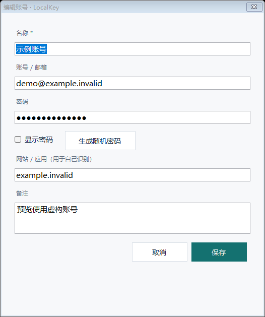

# LocalKey 操作手册

适用版本：0.2.0。运行环境：Windows 10 / 11、.NET Framework 4.8。

LocalKey 用来保存你自己的账号密码，并在需要时填写到浏览器或桌面软件的输入框。当前版本无需设置主密码，记录使用当前 Windows 用户身份加密，只保存到本机。

## 1. 启动与退出

使用便携发行包时，解压后双击包根目录的 `LocalKey.exe` 或 `启动LocalKey.cmd`。使用源码时，先按 [构建说明](docs/BUILDING.md) 编译，再运行根目录启动器或 `dist\0.2.0\LocalKey.exe`。

从旧版升级时，先右键旧版托盘盾牌图标，选择「退出 LocalKey」，再启动新版；使用同一 Windows 用户及兼容版本时，原账号会直接沿用。窗口标题显示「LocalKey 0.2」。程序不会自动替你迁移 Windows 用户密钥。

首次启动会自动建立空密码库。以后启动会自动打开当前 Windows 用户的密码库。程序运行后，任务栏右下角通知区域会出现盾牌图标；看不到时，展开隐藏的托盘图标。

| 操作 | 结果 |
| --- | --- |
| 双击托盘盾牌图标 | 打开账号管理界面 |
| 右键托盘 →「打开密码库」 | 打开账号管理界面 |
| 点击主窗口右上角 × | 隐藏窗口，程序继续在托盘运行 |
| 点击「收起到托盘」 | 清除内存中的账号列表，并隐藏窗口 |
| 右键托盘 →「收起并清除缓存」 | 清除内存中的账号列表，并隐藏窗口 |
| 右键托盘 →「退出 LocalKey」 | 完全退出，快捷键随之失效 |

当前版本不会开机自启；重启电脑后需要手动运行一次。重复运行不会打开第二个实例。

## 2. 快捷键一览

| 快捷键 | 生效位置 | 使用方法与效果 |
| --- | --- | --- |
| **Ctrl + Alt + Space（空格）** | 程序运行时，可在其他窗口使用 | 先点击目标输入框，再按此组合键；唤起 LocalKey，并记住原窗口和输入焦点 |
| **Ctrl + Alt + Space** | LocalKey 主窗口已有焦点时 | 隐藏主窗口，继续在托盘运行 |
| **Enter（回车）** | 通过快捷键唤起的主窗口，且已选中账号 | 等同于「填密码」，将所选记录的密码填回原输入框；**不会同时填写账号** |
| **Enter** | 主窗口显示「本地密码库已收起」时 | 重新打开密码库，无需主密码 |
| **Esc** | 主窗口 | 隐藏主窗口，继续在托盘运行 |
| **Esc** | 新建或编辑账号窗口 | 取消本次编辑，不保存本次修改 |
| **Ctrl + L** | 主窗口 | 清除内存中的账号列表和填写目标，显示「本地密码库已收起」；窗口仍然保留 |
| **Alt + P** | 主窗口，已选中账号 | 开始「定点填密码」倒计时；3秒内重新点击目标密码框 |
| **Ctrl + Shift + C** | 主窗口，已选中账号 | 复制密码，20秒后尝试清除 |
| **Ctrl + Shift + U** | 主窗口，已选中账号 | 复制账号，20秒后尝试清除 |
| **↑ / ↓** | 搜索框 | 切换列表中选中的记录，不必离开搜索框 |
| **Ctrl + Enter** | 自动填写模式，已选中账号 | 等同于「账号 → 密码」 |
| **Esc** | 定点填写倒计时期间 | 取消本次定点填写 |

补充说明：

- 全局唤起快捷键目前固定为 **Ctrl+Alt+Space**，没有自定义入口。
- 新建或编辑账号窗口打开时，全局唤起操作会被忽略；先保存或取消编辑。
- 在管理模式下按 Enter 不会把密码填写到其他软件，因为此时没有指定目标输入框。
- 输入框中的 **Ctrl+A** 是常见的 Windows「全选」操作，不是 LocalKey 的全局快捷键。需要覆盖原有文字时，在目标输入框中全选后再唤起 LocalKey。

## 3. 新建、查找与修改账号

### 新建账号

1. 打开 LocalKey，点击「+ 新建账号」。
2. 填写以下内容。
3. 点击「保存」，记录会加密写入本机。

| 字段 | 建议填写内容 |
| --- | --- |
| 名称（必填） | 容易辨认的名称，例如「工作邮箱」「公司后台」 |
| 账号 / 邮箱 | 登录用户名、邮箱或手机号 |
| 密码 | 对应账号的登录密码 |
| 网站 / 应用 | 网站地址或软件名称，方便识别和搜索 |
| 备注 | 用途、所属环境等补充信息 |

勾选「显示密码」可查看当前编辑框中的密码；取消勾选后恢复遮挡。「生成随机密码」会替换当前编辑框的内容，生成 24 位密码，点击「保存」后才会保存到密码库。此按钮不会替你修改网站或软件中的真实密码。

### 查找账号

在主窗口顶部搜索框输入关键词，可搜索名称、账号、网站 / 应用和备注。搜索不区分大小写，不搜索密码内容。

搜索后，单击需要使用的记录。不要只依赖默认选中的第一条；填写前确认选中了正确账号。

### 修改或删除

- **修改**：选中记录，点击「编辑」，或直接双击记录；修改后点击「保存」。
- **删除**：选中记录，点击「删除」，在弹窗中确认。上一次保存的加密备份中可能仍保留被删除的记录。
- **取消修改**：点击「取消」或按 Esc，本次修改不保存。

## 4. 填写到浏览器或其他软件

填写前，LocalKey 必须已经运行。使用前面三个自动填写按钮时，从目标输入框按快捷键唤起；遇到网页密码框无法识别，直接使用「定点填密码」或复制粘贴。

### 方式一：仅填账号

1. 切到网站或软件，点击账号输入框。
2. 如果框内已有文字，需要替换时先选中原文字，例如按 Ctrl+A。
3. 按 **Ctrl+Alt+Space**，然后松开组合键。
4. 在 LocalKey 中搜索并单击正确记录，核对「即将填写到」显示的窗口。
5. 点击「填账号」。程序切回原输入框，输入账号。

### 方式二：仅填密码

1. 点击目标密码框；需要替换已有内容时，先选中原内容。
2. 按 **Ctrl+Alt+Space**，然后松开组合键。
3. 搜索并选中正确记录，核对目标窗口。
4. 点击「填密码」，也可以按 **Enter**。

此自动模式只有在识别到密码框时才会输入密码。填写完成后，请自行检查并点击网站或软件的登录按钮。

### 方式三：账号 → 密码

适用于按一次 Tab 就能从账号框切换到密码框的表单。

1. 点击目标账号框，必要时先选中已有文字。
2. 按 **Ctrl+Alt+Space**，搜索并选中正确记录。
3. 点击「账号 → 密码」。
4. 程序依次执行：输入账号 → 按一次 Tab → 检查下一控件是否为密码框 → 输入密码。

如果账号框和密码框之间有验证码、其他输入框或按钮，建议分别使用「填账号」和「填密码」。如果 Tab 后未识别到密码框，程序会停止，账号可能已经填入；检查表单后再单独填写密码。

### 方式四：定点填密码（解决网页密码框识别失败）

1. 在 LocalKey 中选中正确账号。
2. 点击 **「定点填密码（3秒）」**，或按 **Alt+P**。主窗口隐藏，屏幕右下角显示倒计时。
3. 在3秒内，**重新点击一次网页或软件的密码框**。需要替换旧内容时，在点击后选中旧内容。
4. 松开鼠标及按键，保持该输入框焦点，等待倒计时结束。
5. 程序只往你选中的一个可编辑输入框填写密码，不会按 Tab，也不会自动提交。

没有检测到新的点击、目标无法编辑或填写时焦点变化，程序不会继续填写。倒计时期间按 Esc 可以取消，也可按 Ctrl+Alt+Space 取消并返回主界面。

此模式不依赖输入框的密码标记。请明确点击密码框；如果选到普通文本框，密码可能明文显示。账号和验证码仍需要分别处理。

### 方式五：复制后粘贴

1. 选中正确账号，点击「复制账号」或「复制密码」。
2. 到目标输入框按 **Ctrl+V** 粘贴。
3. 如需替换已有内容，先在目标框中全选原文字。

复制内容在20秒后尝试清除，仅清除 LocalKey 本次写入的剪贴板内容；如果你随后复制了其他内容，会保留新内容。清除需要程序仍在运行且剪贴板未被其他程序占用；退出、收起清除缓存或锁屏时也会尝试清除。程序请求 Windows 排除该内容的历史记录与云同步，但其他剪贴板软件仍可能读取。

### 填写时注意

- 程序不会自动清空输入框。没有选中原有文字时，可能在光标位置追加内容。
- 程序不会自动点击登录、发送表单或按 Enter 提交。自动与定点填写不使用剪贴板；点击复制按钮时才写入剪贴板。
- 点击填写后，松开鼠标和 Ctrl、Alt、Shift 等按键，等待填写完成；期间不要切换窗口或点击其他输入框。
- 窗口、输入焦点或按键状态发生变化时，程序会停止。目标框可能已有部分文字，重试前先检查内容。
- 「网站 / 应用」字段用于识别和搜索，当前版本不会根据网址自动匹配账号，也不会替你打开网站。

## 5. 管理模式与填写模式

| 打开方式 | 当前模式 | 能否直接填写 |
| --- | --- | --- |
| 双击 EXE、双击托盘、托盘菜单打开 | 管理模式 | 可以增删改查、定点填写、复制账号和密码；自动填写需要先在目标输入框按快捷键唤起 |
| 在其他软件的输入框中按 Ctrl+Alt+Space | 填写模式 | 捕获到有效目标且选中记录后，可使用填写按钮 |

如果前三个自动填写按钮为灰色，先确认已选中账号；再回到目标输入框，点击输入框并重新按快捷键唤起。定点与复制按钮在选中记录后即可使用。

## 6. 自动收起与无需主密码的含义

程序在约 5 分钟未记录到密码库使用活动，或 Windows 已闲置约 5 分钟时，会清除内存中的账号列表；Windows 锁屏或注销时也会清除。再次打开会使用当前 Windows 用户身份自动解密，不需要输入主密码。

普通关闭窗口或按 Esc 只是隐藏；如需立即清除内存中的列表，使用 Ctrl+L、「收起到托盘」或托盘中的「收起并清除缓存」。这不会删除磁盘上已保存的账号。

编辑账号时请及时保存。长时间不保存而触发自动收起，编辑窗口可能关闭，未保存的修改会丢失。

因为没有独立主密码，能够操作当前已登录 Windows 会话的人，也能打开 LocalKey。收起和清除缓存不等同于设置了额外的访问密码。

## 7. 数据文件与备份恢复

| 文件 | 位置与作用 |
| --- | --- |
| 当前密码库 | `%LOCALAPPDATA%\LocalKey\vault.lkey` |
| 上一次保存的加密备份 | `%LOCALAPPDATA%\LocalKey\vault.lkey.bak` |

可在文件资源管理器地址栏输入 `%LOCALAPPDATA%\LocalKey`，找到这两个文件。密码库不在项目的 `dist` 目录里；移动 EXE 不会自动移动密码库。

名称、账号、密码、网站与备注整体加密。记录会在保存时自动写入，不需要另做「保存整个密码库」的操作。

需要恢复上一次备份时：

1. 从托盘菜单完全退出 LocalKey。
2. 将现有 `vault.lkey` 和 `vault.lkey.bak` 复制到其他位置留存，避免覆盖唯一副本。
3. 将 `.bak` 文件复制一份到原目录，命名为 `vault.lkey`，替换当前文件。
4. 使用原来的 Windows 用户重新启动 LocalKey，检查记录。

备份仍依赖原 Windows 用户的加密密钥。复制到其他用户或电脑、重装系统后，可能无法解密；当前版本没有跨电脑迁移或导出功能。

## 8. 常见问题

| 现象 | 处理方法 |
| --- | --- |
| 按快捷键没有反应 | 检查程序是否已运行、托盘是否有盾牌图标；关闭编辑窗口后重试。如果启动时提示快捷键被占用，解除其他软件的快捷键冲突后重启 LocalKey |
| 填写按钮为灰色 | 确认选中了一条记录；回到目标输入框点击后，按 Ctrl+Alt+Space 重新唤起 |
| 提示目标窗口或输入焦点变化 | 检查是否已经输入部分内容；重新点击正确输入框并唤起，填写期间不要操作其他窗口 |
| 提示未识别到密码框 | 使用「定点填密码（3秒）」，在倒计时内重新点击密码框；也可「复制密码」后 Ctrl+V 粘贴 |
| 定点填写提示没有新的点击 | 再次点击「定点填密码」，在倒计时内对目标密码框重新按下并松开鼠标；仅原来已有焦点不算新的点击 |
| 提示无法切回窗口或 Windows 拒绝输入 | 确认目标窗口仍然打开。管理员权限窗口、受保护窗口或 Windows 安全桌面可能无法填写 |
| 账号填写成功，但密码没有填写 | 表单的 Tab 顺序可能没有直接到密码框；请点击密码框后单独使用「填密码」 |
| 输入内容重复或拼接 | 程序保留原有文字；需要替换时，先在目标框选中原内容，再重新填写 |
| 提示内容为空或包含控制字符 | 编辑记录并检查待填字段；空内容及含换行、Tab 等控制字符的内容无法通过键盘填写 |
| 提示当前 Windows 用户无法解密或文件损坏 | 确认使用原 Windows 用户；保留原文件，检查上一次加密备份，按上面的步骤恢复 |
| 关闭窗口后快捷键仍有效 | 关闭窗口只会回到托盘；完全退出请使用托盘菜单「退出 LocalKey」 |

当前新增了未提供密码标记的输入框测试。不同软件的自定义控件支持情况仍可能不同；验证范围见 [测试说明](docs/TESTING.md)，数据保护边界见 [隐私说明](docs/PRIVACY.md)。
